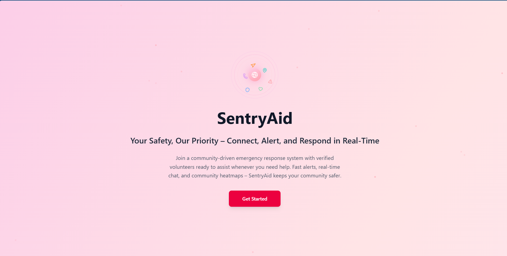
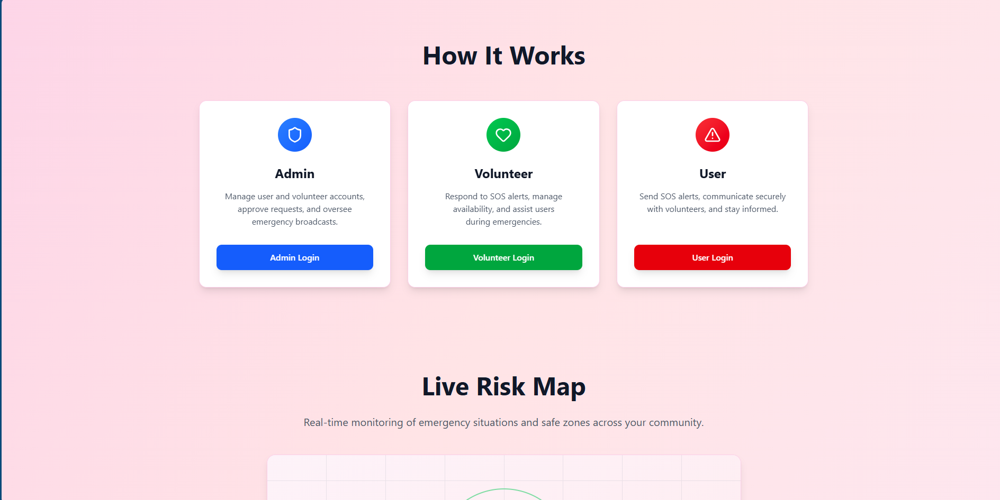
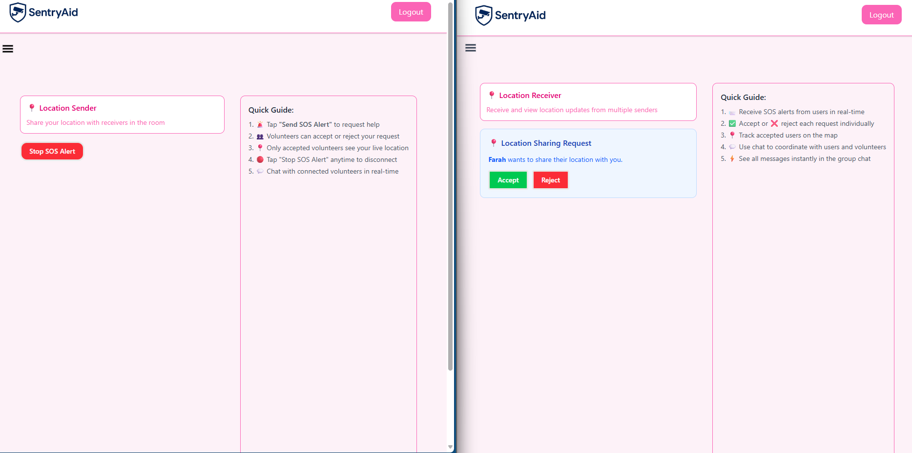
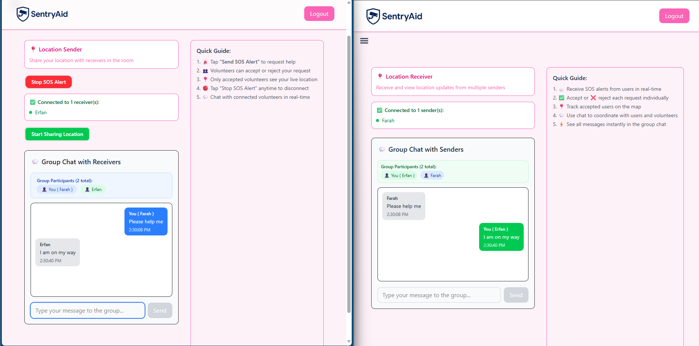
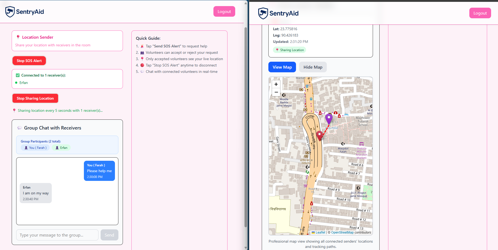

# SentryAid 🛡️  

**SentryAid** is a comprehensive safety and emergency response platform designed specifically for women. Built on the **MERN stack**, the application provides a secure environment where users can **send SOS alerts**, receive **instant notifications**, and **report inappropriate behavior** by volunteers.  

The platform empowers **volunteers** to actively participate in emergency response by **accepting SOS requests**, offering assistance, and maintaining open communication with users via the in-app chat system. Volunteers can manage their availability and contribute to a coordinated and efficient support network.  

Administrators oversee the system by broadcasting urgent updates, managing user and volunteer reports, and ensuring overall safety, thereby creating a **robust ecosystem for rapid response and community support**.

---

## 🛠️ Tech Stack  
| Layer         | Technology |
|---------------|------------|
| Frontend      | React + Vite, TailwindCSS |
| Backend       | Node.js, Express.js |
| Database      | MongoDB + Mongoose |
| Real-Time     | Socket.IO |

---

## 💻 Run on your laptop (Windows)

### You need
1. **Node.js** — [nodejs.org](https://nodejs.org/) (v18+)
2. **MongoDB** — installed and running on your PC ([download](https://www.mongodb.com/try/download/community))

### One-time setup
```powershell
cd SentryAid
.\setup.ps1
```

### Start everything (backend + frontend)
```powershell
npm run dev
```

**Local dev:** signups are auto-approved — log in right after registering.  
Default admin (if none exists): **admin** / **admin123** → `/adminLogin`

| Service  | URL |
|----------|-----|
| App      | http://localhost:5173/ |
| API      | http://localhost:5000/api |
| Health   | http://localhost:5000/api/health |

### Run separately (optional)
```powershell
npm run dev:backend   # port 5000
npm run dev:frontend  # port 5173
```

### Environment files
Copy examples if missing:
```powershell
copy backend\.env.example backend\.env
copy frontend\.env.example frontend\.env
```

- **`backend/.env`** — uses local MongoDB `mongodb://localhost:27017/sentryaid`
- **`frontend/.env`** — points to `http://localhost:5000`

---

## ⚡ Features  

### 👩 User Features  
- Register and maintain **personal profile** (with medical info, blood group, allergies, etc.)  
- Trigger **SOS alerts** with one click in emergencies  
- View **real-time notifications** from admins  
- Submit and track **reports against volunteers**  

### 👨‍💼 Admin Features  
- Approve or manage **volunteers and users**  
- Broadcast **notifications** to all users instantly  
- View, review, and update **report statuses** (`under_review`, `resolved`, `dismissed`)  
- Monitor **emergency SOS alerts**  

### 🙋 Volunteer Features  
- View **assigned notifications**  
- Respond to **SOS requests**  
- Maintain **basic volunteer info**  

---

## 🧑‍💻 How It Works  

1. **User Onboarding** — User registers and logs in; personal info stored in MongoDB  
2. **SOS Flow** — User presses SOS → alert stored → admin/volunteers notified  
3. **Notifications** — Admin bulletin appears on user dashboards  
4. **Reports** — User files complaint → admin updates status → user sees progress  

---

## 📸 Screenshots  

### 1️⃣ Website Homepage  
<table>
  <tr>
    <td></td>
    <td></td>
  </tr>
</table>  

### 2️⃣ User & Volunteer SOS  
<table>
  <tr>
    <td></td>
    <td></td>
  </tr>
  <tr>
    <td style="text-align:center;"></td>
  </tr>
</table>  
